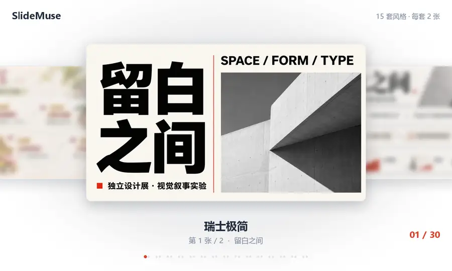
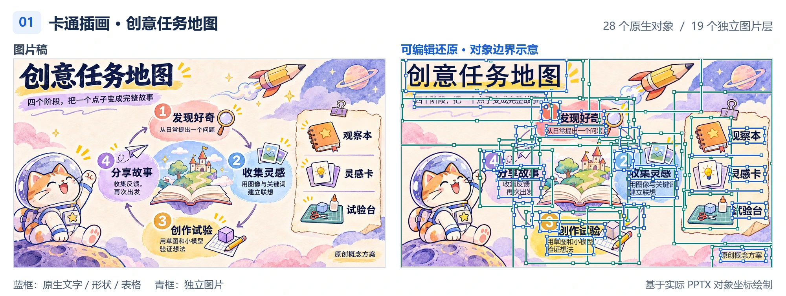
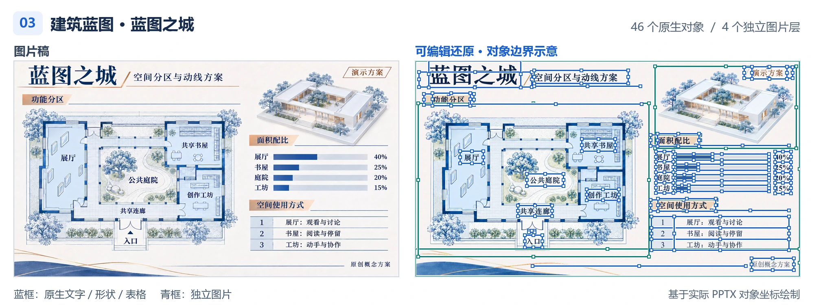

<div align="center">

# SlideMuse

**Turn your content into slides worth presenting.**

Create visually consistent image decks from PDFs, papers, reports, and notes, with editable PPTX reconstruction when needed.<br>
For work updates, teaching, research, competition pitches and defenses, product pitches, and creative presentations.

[](CHANGELOG.md)
[](https://github.com/helloo1568/slidemuse/actions/workflows/ci.yml)
[](LICENSE)

[简体中文](README.md) · **English**

[Showcase](#showcase) · [Editable slides](#editable) · [Competition specialty](#competition) · [Quick start](#quick-start) · [Guide](docs/guide.en.md)

</div>

<a id="showcase"></a>



<p align="center"><sub>15 styles × 2 slides each · 2 seconds per slide · Each pair plays together</sub></p>

<a id="editable"></a>

## Beautiful slides you can keep editing

Generate complete slide images first, then reconstruct them. Text, shapes, and tables become native objects; complex illustrations and photos become separate, replaceable image layers.

<a href="https://github.com/helloo1568/slidemuse/blob/main/docs/assets/portfolio/editable-cartoon.png"></a>

<a href="https://github.com/helloo1568/slidemuse/blob/main/docs/assets/portfolio/editable-luxury.png"></a>

<a href="https://github.com/helloo1568/slidemuse/blob/main/docs/assets/portfolio/editable-blueprint.png"></a>

<sub>Source images on the left; PowerPoint renders on the right. Outlines and handles are drawn from actual PPTX object coordinates. Click any image to view it at full size. Showcase slide content is in Chinese.</sub>

[Download these 3 editable slides](https://github.com/helloo1568/slidemuse/blob/main/showcase/editable/three-styles.pptx?raw=true) · [Editable object types](docs/guide.en.md) · [More work](https://github.com/helloo1568/slidemuse/blob/main/docs/style-showcase.md)

<a id="competition"></a>

## Competition presentations are a specialty

Turn proposals, papers, research reports, and competition briefs into presentations built around the problem, solution, innovation, validation, and value. Make the technical work and results easier to explain.

| Scenario | Representative competitions and presentation focus |
| :--- | :--- |
| **Innovation and entrepreneurship** | Challenge Cup, China International College Students' Innovation Competition, and 3-Chuang: user needs, innovation, validation, and development plans. |
| **Technology and engineering** | Computer design, Software Cup, IC design, and transportation competitions: technical approach, implementation, test results, and live demos. |
| **Research and case analysis** | CP Cup, MPA / MPAcc, IMA, and CFA: methods, data analysis, key findings, and recommendations. |
| **Teaching and academic presentations** | Teaching-innovation competitions, lesson presentations, and school or provincial modeling defenses: objectives, methods, evidence, and results. |

[Explore all competition scenarios](https://github.com/helloo1568/slidemuse/blob/main/docs/competition-scenarios.en.md) · [Browse 24 slides of complete competition decks](https://github.com/helloo1568/slidemuse/blob/main/docs/competition-portfolio.md)

<a id="quick-start"></a>

## Quick start

Send this to **Codex / Claude Code / OpenCode / WorkBuddy / Trae / Qoder**:

```text
Install SlideMuse from https://github.com/helloo1568/slidemuse .
Run the repository's install.py to register the skill, install isolated dependencies, and verify the setup.
If multiple clients are detected, pass --client for the one I am using.
```

Then attach your material and ask (Codex also accepts `$slidemuse`):

```text
Use the slidemuse skill to turn this report into a 10-slide project update for my team.
Show a slide-by-slide content plan, then four style overviews for me to choose from.
After I choose a style, create the image deck and reconstruct an editable PPTX.
```

The default flow confirms content, then chooses a style. You can request an image-only deck or reconstruction of existing slide images. Delegated choices continue without repeated approval.

<details>
<summary>Manual installation and requirements</summary>

Requires **Python 3.10+**, plus Git for the clone command below.

```sh
git clone https://github.com/helloo1568/slidemuse.git slidemuse
python slidemuse/install.py
```

If multiple clients are detected, specify the current one, for example:

```sh
python slidemuse/install.py --client codex
python slidemuse/install.py --client workbuddy
python slidemuse/install.py --client trae
python slidemuse/install.py --client qoder
```

Use `--client trae-cn` for Trae CN and `--client qoder-cn` for Qoder CN. See [client setup](docs/clients.en.md) for installation paths and activation.

The host agent provides document reading, vision, image generation, and local file tools. PPTX rendering uses an installed PowerPoint or LibreOffice + Poppler. See the [installation guide](docs/guide.en.md).

</details>

## From source to delivery

| Content & style | Image deck | Editable reconstruction (optional) |
| :--- | :--- | :--- |
| Draft each slide and compare four visual directions | Generate, review, and assemble an image-based PPTX | Rebuild text, shapes, tables, and independent assets from the images |
| Set the story and layout | Get complete images and a presentation | Get a PPTX you can keep editing |

Supports speaker notes, task recovery, and local revisions. Existing slide images, scanned PDFs, and image-based PPTX files can enter reconstruction directly.

## Documentation & community

| Your next step | Resource |
| :--- | :--- |
| Installation and workflow | [Guide](docs/guide.en.md) · [Client setup](docs/clients.en.md) · [Agent skill](SKILL.md) |
| Commands, recovery, and delivery checks | [CLI guide](docs/cli.en.md) · [Pipeline](references/pipeline.md) |
| Image generation and editable reconstruction | [Generation backend](references/generate-backend.md) · [Reconstruction backend](references/editable-backend.md) |
| Speaker notes, precise charts, and data updates | [Speaker notes](references/speaker-notes.md) · [Chart reliability](references/chart-reliability.md) |
| Competition scenarios and complete decks | [Scenario reference](https://github.com/helloo1568/slidemuse/blob/main/docs/competition-scenarios.en.md) · [Complete portfolio](https://github.com/helloo1568/slidemuse/blob/main/docs/competition-portfolio.md) |
| Feedback and contributions | [Discussions](https://github.com/helloo1568/slidemuse/discussions) · [Contributing](CONTRIBUTING.md) · [Changelog](CHANGELOG.md) |

Thanks to [PPT Master](https://github.com/hugohe3/ppt-master), [banana-slides](https://github.com/Anionex/banana-slides), [PPTAgent](https://github.com/icip-cas/PPTAgent), and community tutorial authors. Integrated backends retain MIT attribution to [codex-ppt-skill](https://github.com/ningzimu/codex-ppt-skill) and [image-to-editable-ppt-skill](https://github.com/ningzimu/image-to-editable-ppt-skill); see [sources and design decisions](references/research.md).

<div align="center">

[MIT License](LICENSE) © 2026 风清云影（[helloo1568](https://github.com/helloo1568)）

</div>
