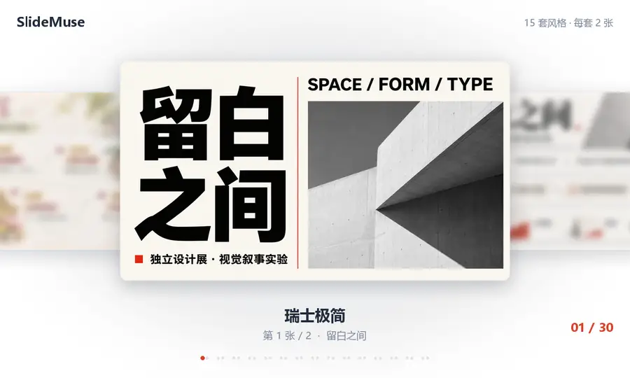
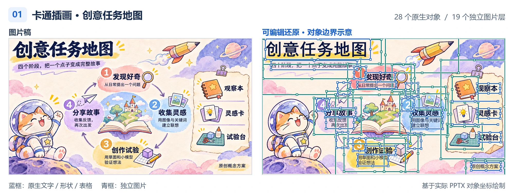
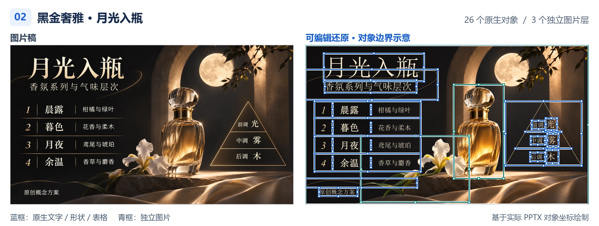
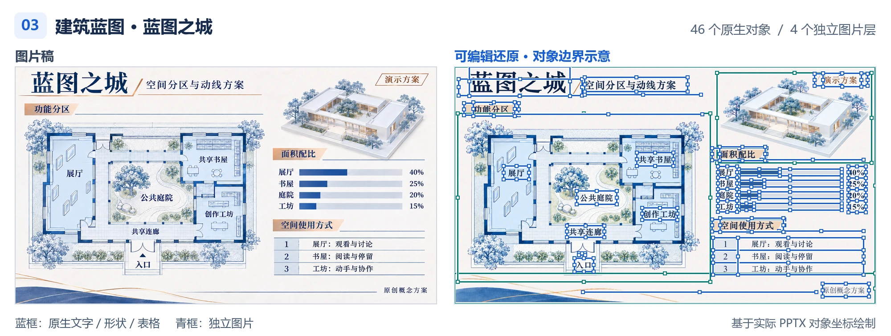
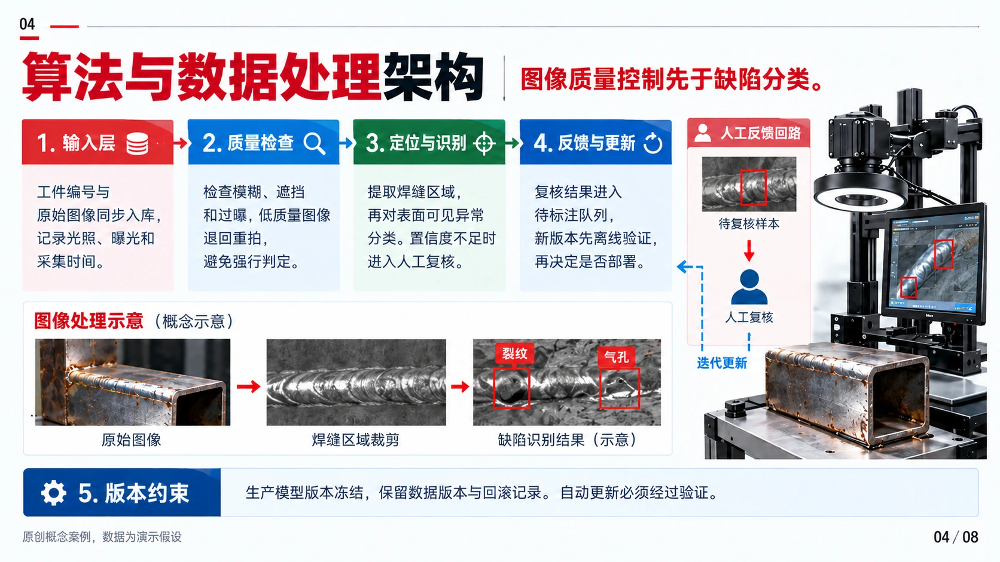
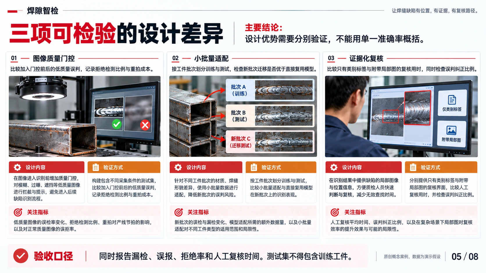
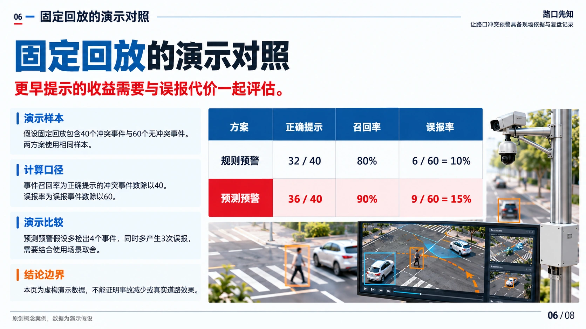
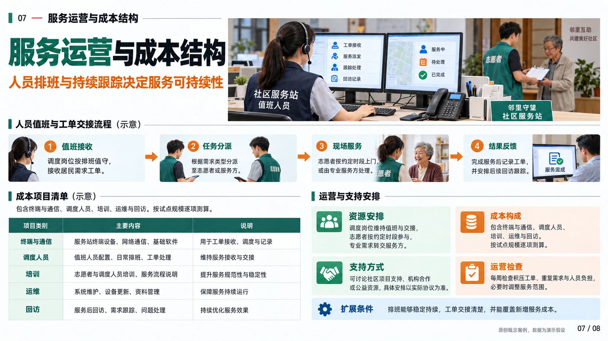

<div align="center">

# SlideMuse

**Turn your content into slides worth presenting.**

Create visually consistent image decks from PDFs, papers, reports, and notes, with editable PPTX reconstruction when needed.<br>
For work updates, teaching, research, competition pitches and defenses, product pitches, and creative presentations.

[](CHANGELOG.md)
[](https://github.com/helloo1568/slidemuse/actions/workflows/ci.yml)
[](LICENSE)

[简体中文](README.md) · **English**

[Showcase](#showcase) · [Editable slides](#editable) · [Competition presentations](#competition) · [Quick start](#quick-start) · [Guide](docs/guide.en.md)

</div>

<div align="center">

<a href="https://fyai.uk/?utm_source=github&utm_medium=readme&utm_campaign=slidemuse"></a>

**Sponsored by [FengYun AI](https://fyai.uk/?utm_source=github&utm_medium=readme&utm_campaign=slidemuse)** · a cost-effective AI API relay<br>
GPT calls from **0.08× rate** · image generation **¥0.02 per image** (1K/2K/4K same price)<br>
Supports Claude, GPT, Grok, Gemini, and Chinese models · **The lowest prices online, zero adulteration, and high-speed, full-capability models with no intelligence downgrades.**

No Codex subscription or overseas network access, but want to get the most out of SlideMuse?<br>
FengYun AI's OpenAI-compatible API plugs into the skill's generation backend — one paste to set up · [Setup guide](docs/fyai-quickstart.en.md)

</div>

<a id="showcase"></a>



<p align="center"><sub>15 styles × 2 slides each · 2 seconds per slide · Each pair plays together</sub></p>

<a id="editable"></a>

## Beautiful slides you can keep editing

Generate complete slide images first, then reconstruct them. Text, shapes, and tables become native objects; complex illustrations and photos become separate, replaceable image layers.

<a href="https://github.com/helloo1568/slidemuse/blob/main/docs/assets/portfolio/editable-cartoon.png"></a>

<a href="https://github.com/helloo1568/slidemuse/blob/main/docs/assets/portfolio/editable-luxury.png"></a>

<a href="https://github.com/helloo1568/slidemuse/blob/main/docs/assets/portfolio/editable-blueprint.png"></a>

<sub>Source images on the left; PowerPoint renders on the right. Outlines and handles are drawn from actual PPTX object coordinates. Click any image to view it at full size. Showcase slide content is in Chinese.</sub>

[Download these 3 editable slides](https://github.com/helloo1568/slidemuse/blob/main/showcase/editable/three-styles.pptx?raw=true) · [Editable object types](docs/guide.en.md) · [More work](https://github.com/helloo1568/slidemuse/blob/main/docs/style-showcase.md)

<a id="competition"></a>

## Competition presentations that explain innovation, technology, and results

Bring your proposal, paper, research report, and competition brief to SlideMuse to build a presentation around the problem, solution, innovation, and validation.

<table>
<tr>
<td width="50%" align="center">
<a href="https://github.com/helloo1568/slidemuse/blob/main/showcase/competition-portfolio/assets/weld/04.webp"></a><br>
<strong>Technical architecture</strong><br><sub>Make the system and workflow clear</sub>
</td>
<td width="50%" align="center">
<a href="https://github.com/helloo1568/slidemuse/blob/main/showcase/competition-portfolio/assets/weld/05.webp"></a><br>
<strong>Innovation comparison</strong><br><sub>Connect design differences to validation</sub>
</td>
</tr>
<tr>
<td width="50%" align="center">
<a href="https://github.com/helloo1568/slidemuse/blob/main/showcase/competition-portfolio/assets/junction/06.webp"></a><br>
<strong>Data validation</strong><br><sub>Show comparisons and measurement methods</sub>
</td>
<td width="50%" align="center">
<a href="https://github.com/helloo1568/slidemuse/blob/main/showcase/competition-portfolio/assets/neighbor/07.webp"></a><br>
<strong>Implementation</strong><br><sub>Explain delivery and resource needs</sub>
</td>
</tr>
</table>

<sub>Selected slides from three original concept decks, 24 slides in total. These are image-based examples with fictional business and technical data. Click any slide to view it at full size. Slide content is in Chinese.</sub>

- **Content structure**: organize the problem, solution, innovation, and validation around the competition brief and supplied material.
- **Visual explanation**: support the main conclusions with technical workflows, system architecture, comparisons, and data.
- **Live presentation**: plan slide content for the allotted time, with speaking outlines, scripts, and speaker notes when requested.

[Browse all 24 competition slides](https://github.com/helloo1568/slidemuse/blob/main/docs/competition-portfolio.md) · [Explore competition scenarios](https://github.com/helloo1568/slidemuse/blob/main/docs/competition-scenarios.en.md)

### Competition and defense scenarios

| Competition / scenario | Presentation focus |
| :--- | :--- |
| [中国国际大学生创新大赛](https://hudong.moe.gov.cn/srcsite/A08/s5672/202607/t20260731_1445670.html) | Problem, innovation, validation, team, and development plan. |
| [“挑战杯”中国大学生创业计划竞赛](https://www.tiaozhanbei.net/focus) | Customer needs, product, market, business model, and execution. |
| [全国大学生电子商务“创新、创意及创业”挑战赛](https://www.3chuang.net/) | E-commerce context, ideas, operations, project results, and value. |
| [iGEM](https://igem.org/) | Project background, biological design (Parts), evidence, safety and ethics, human practices, and team collaboration. |
| [Hult Prize](https://www.hultprize.org/) | Social problem, solution and business model, quantified impact, team, and pitch delivery. |
| [Microsoft Imagine Cup](https://imaginecup.microsoft.com/) | Technical implementation, product usability, market and team, and demo readiness. |
| [“挑战杯”全国大学生课外学术科技作品竞赛](https://www.tiaozhanbei.net/focus) | Research question, methods, novelty, results, and applications. |
| [中国大学生计算机设计大赛](https://jsjds.blcu.edu.cn/) | Positioning, feature demo, implementation, difficulty and workload, and on-site Q&A. |
| [中国软件杯大学生软件设计大赛](https://www.cnsoftbei.com/) | Six-minute brief interpretation, architecture, feature demo, and code and docs, with four minutes left for questions. |
| 中国大学生服务外包创新创业大赛 | Fit with the company brief, product completeness, business model and traction, demo, and team roles. |
| [全国大学生信息安全竞赛（作品赛）](http://www.ciscn.cn/) | Technical novelty, implementation and live demo, practical or applied value, and defense. |
| [全国大学生集成电路创新创业大赛](https://univ.ciciec.com/) | Task metrics achieved, engineering implementation and measurements, industrial fit, and judge Q&A. |
| [全国大学生嵌入式芯片与系统设计竞赛](https://www.socchina.net/) | Chip platform use, system integration and demo, documentation, and defense. |
| 全国大学生机械创新设计大赛 | Novel and practical topic, mechanism design and methods, manufacturing and function, live demo and defense. |
| [全国大学生交通运输科技大赛（交科赛）](http://www.nactrans.net/) | Transportation problem, solution design, technical route, validation, and innovation value. |
| 全国大学生化工设计竞赛 | Process design and decarbonization, energy and mass integration, economics, and oral report with two defense rounds. |
| 世界职业院校技能大赛 | Explain project design, workflow, core skills, and results alongside practical operations, physical evidence, and measured data; prepare supporting slides according to the current track's requirements. |
| [全国大学生结构设计竞赛](http://www.structurecontest.com/) | Theoretical scheme and calculations, model build and loading performance, on-site statement, and teamwork. |
| [全国大学生节能减排社会实践与科技竞赛](https://jienengjianpai.cn/) | Energy and emission problem, technical or social solution, measured data, reduction benefit, and scalability. |
| [全国三维数字化创新设计大赛（3D 大赛）](https://3dds.3ddl.net/) | Digital modeling and innovation, engineering usefulness, business or social value, and pitch with judge Q&A. |
| [全国大学生广告艺术大赛（大广赛·策划案类）](https://www.sun-ada.net/) | Brand and audience insight, creative fit with the brief, executable planning, and live proposal delivery. |
| [睿抗机器人开发者大赛（RAICOM）](https://www.raicom.com.cn/) | Task completion, design creativity, and slide-based defense. |
| [中国研究生创新实践系列大赛](https://cpipc.acge.org.cn/) | Technical novelty, implementation and results, and application value; determine anonymity requirements and presentation and Q&A durations for the specific contest, edition, and stage. |
| [“正大杯”全国大学生市场调查与分析大赛](https://www.china-cssc.org/show-568-1912-1.html) | Research questions, survey design, data analysis, findings, and recommendations. |
| [全国大学生生命科学竞赛](https://www.culsc.cn/) | Scientific question, experimental design, data and statistics, conclusion reliability, and Q&A. |
| [中国大学生工程实践与创新能力大赛](http://www.gcxl.edu.cn/) | Task breakdown, design comparison, structure and control, measured results, and iteration. |
| [中国研究生公共管理案例大赛](https://cpipc.acge.org.cn/cw/hp/8) | Case representativeness, theoretical framework, problem diagnosis, feasible measures, and Q&A. |
| [中国 MPAcc 学生案例大赛](http://alds.mpaccesc.ruc.edu.cn/) | Financial analysis, problem diagnosis, implementation, data support, and defense. |
| [IMA 校园管理会计案例大赛](https://casecompetition.imachina.org.cn/) | Application of management accounting tools, data modeling, feasibility, and presentation and Q&A. |
| [CFA Institute Research Challenge](https://researchchallenge.cfainstitute.org/) | Valuation model, recommendation and target price, industry and moat, English delivery, and disclosures. |
| [全国高校教师教学创新大赛](https://nticct.cahe.edu.cn/) | Teaching pain points, innovation and course redesign, assessment reform, evidence (data and student feedback), and scalability. |
| [田家炳杯全国师范院校师范生教学技能竞赛](https://qgjxjn.zjnu.edu.cn/) | Objectives aligned to standards, learner analysis, lesson design, board work and slides, and classroom adaptability. |
| 全国中小学实验教学说课活动 | Experiment improvement, objective attainment, safety and standards, and lesson presentation. |
| **大创 (undergraduate innovation and entrepreneurship training projects)** | Proposal defenses, progress reports, and final presentations: project objectives, methods, execution, progress, outcomes, and next steps. |
| **Thesis defenses and research group updates** | Research question, related work, methods, experiments, contributions, and future work. |
| **School or provincial mathematical-modeling defenses and paper presentations** | Problem analysis, assumptions and models, solution methods, validation, sensitivity analysis, and model evaluation. |

<a id="quick-start"></a>

## Quick start

Send this to **Codex / Claude Code / OpenCode / WorkBuddy / Trae / Qoder**:

```text
Install SlideMuse from https://github.com/helloo1568/slidemuse .
Run the repository's install.py to register the skill, install isolated dependencies, and verify the setup.
If multiple clients are detected, pass --client for the one I am using.
```

Then attach your material and ask (Codex also accepts `$slidemuse`):

**Example 1: General presentations**

```text
Use the slidemuse skill to turn this report into a 10-slide project update for my team.
Show a slide-by-slide content plan, then four style overviews for me to choose from.
After I choose a style, create the image deck and reconstruct an editable PPTX.
```

**Example 2: Competition presentations**

```text
Use the slidemuse skill to create an 8-minute competition presentation from this proposal and competition brief.
Focus on the problem, technical solution, innovation, and validation results, with a speaking outline for each slide.
Show a slide-by-slide content plan, then four style overviews for me to choose from.
After I choose a style, create the image deck and reconstruct an editable PPTX.
```

The default flow confirms content, then chooses a style. You can request an image-only deck or reconstruction of existing slide images. Delegated choices continue without repeated approval.

<details>
<summary>Manual installation and requirements</summary>

Requires **Python 3.10+**, plus Git for the clone command below.

```sh
git clone https://github.com/helloo1568/slidemuse.git slidemuse
python slidemuse/install.py
```

If multiple clients are detected, specify the current one, for example:

```sh
python slidemuse/install.py --client codex
python slidemuse/install.py --client workbuddy
python slidemuse/install.py --client trae
python slidemuse/install.py --client qoder
```

Use `--client trae-cn` for Trae CN and `--client qoder-cn` for Qoder CN. See [client setup](docs/clients.en.md) for installation paths and activation.

The host agent provides document reading, vision, image generation, and local file tools. PPTX rendering uses an installed PowerPoint or LibreOffice + Poppler. See the [installation guide](docs/guide.en.md).

</details>

## From source to delivery

| Content & style | Image deck | Editable reconstruction (optional) |
| :--- | :--- | :--- |
| Draft each slide and compare four visual directions | Generate, review, and assemble an image-based PPTX | Rebuild text, shapes, tables, and independent assets from the images |
| Set the story and layout | Get complete images and a presentation | Get a PPTX you can keep editing |

Supports speaker notes, task recovery, and local revisions. Existing slide images, scanned PDFs, and image-based PPTX files can enter reconstruction directly.

## Documentation & community

| Your next step | Resource |
| :--- | :--- |
| Installation and workflow | [Guide](docs/guide.en.md) · [Client setup](docs/clients.en.md) · [Agent skill](SKILL.md) |
| Commands, recovery, and delivery checks | [CLI guide](docs/cli.en.md) · [Pipeline](references/pipeline.md) |
| Image generation and editable reconstruction | [Generation backend](references/generate-backend.md) · [Reconstruction backend](references/editable-backend.md) |
| Speaker notes, precise charts, and data updates | [Speaker notes](references/speaker-notes.md) · [Chart reliability](references/chart-reliability.md) |
| Competition scenarios and complete decks | [Scenario reference](https://github.com/helloo1568/slidemuse/blob/main/docs/competition-scenarios.en.md) · [Complete portfolio](https://github.com/helloo1568/slidemuse/blob/main/docs/competition-portfolio.md) |
| Feedback and contributions | [Discussions](https://github.com/helloo1568/slidemuse/discussions) · [Contributing](CONTRIBUTING.md) · [Changelog](CHANGELOG.md) |

Thanks to [PPT Master](https://github.com/hugohe3/ppt-master), [banana-slides](https://github.com/Anionex/banana-slides), [PPTAgent](https://github.com/icip-cas/PPTAgent), and community tutorial authors. Integrated backends retain MIT attribution to [codex-ppt-skill](https://github.com/ningzimu/codex-ppt-skill) and [image-to-editable-ppt-skill](https://github.com/ningzimu/image-to-editable-ppt-skill); see [sources and design decisions](references/research.md).

<div align="center">

[MIT License](LICENSE) © 2026 风清云影（[helloo1568](https://github.com/helloo1568)）

</div>
