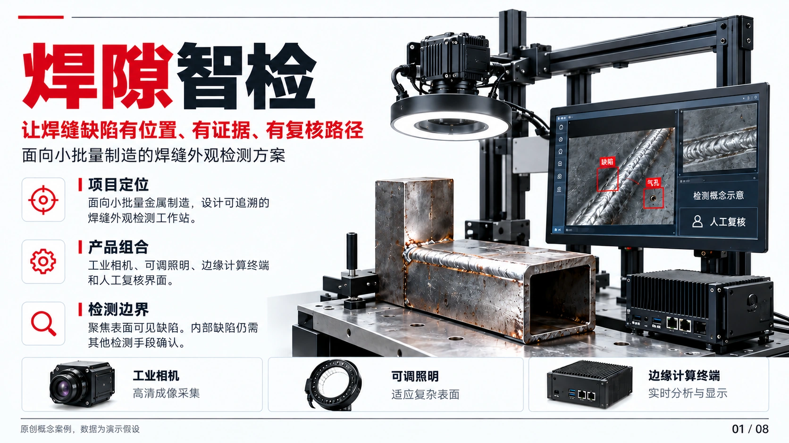
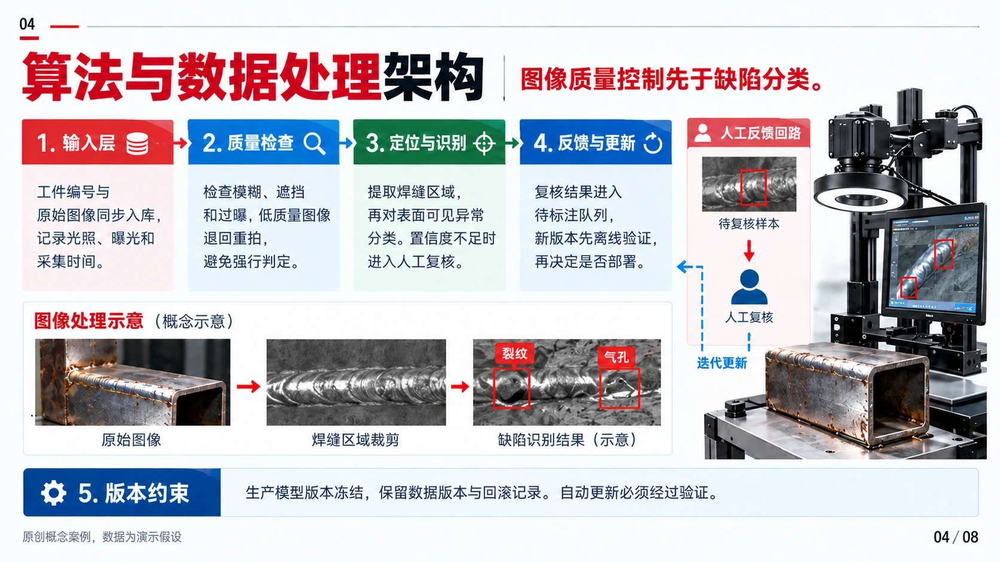
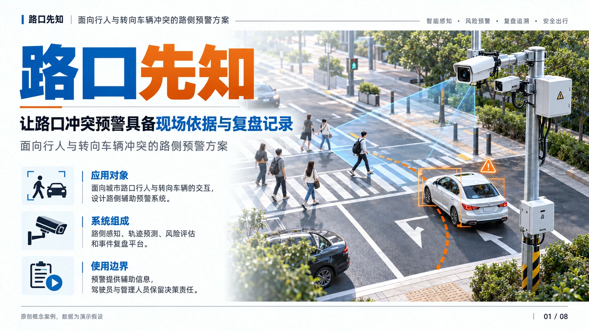
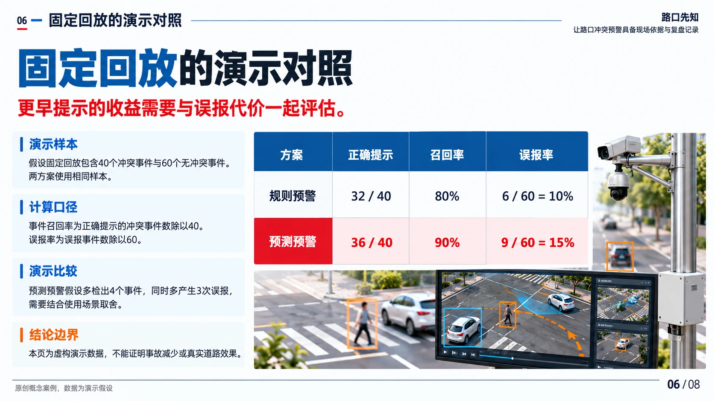
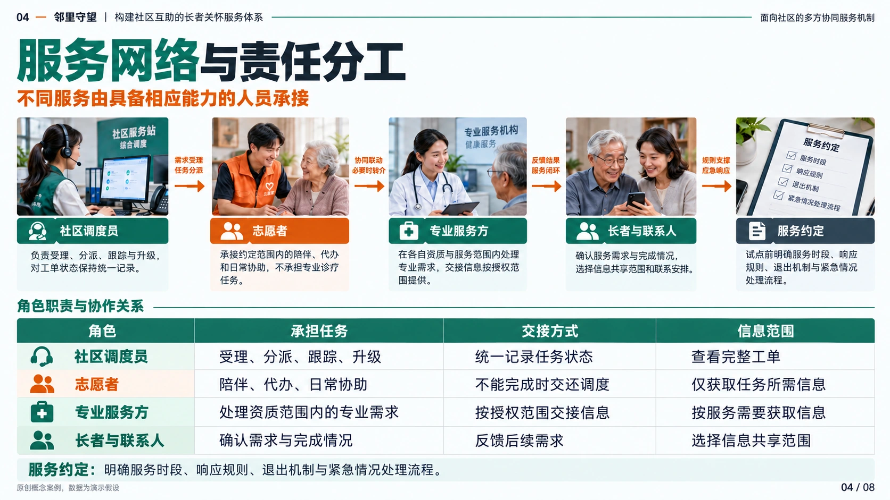

<div align="center">


# SlideMuse · 视觉优先的 AI PPT 技能

**先把 PPT 做得值得展示，再让它可编辑。**

将书籍、PDF、论文与报告变成风格统一的图片 PPT，按需继续还原为原生可编辑 PPTX。<br>
重点面向**挑战杯（大挑/小挑）、中国国际大学生创新大赛、计算机设计大赛、软件杯、服创大赛、信息安全作品赛、集创赛、嵌入式芯片赛、机创赛、化工设计竞赛、结构设计竞赛、交科赛、三创赛、正大杯、生命科学竞赛、节能减排、工创赛、3D 大赛、大广赛、睿抗、研创赛、MPA/MPAcc 案例大赛、IMA、CFA、iGEM、教学创新大赛、大创等竞赛与答辩场景**，也适用于**学术汇报、论文答辩、项目路演、课程展示与电影质感 PPT**，支持图片转可编辑 PPT。

[](https://github.com/helloo1568/slidemuse/actions/workflows/ci.yml)
[](CHANGELOG.md)
[](requirements.txt)
[](LICENSE)

**简体中文** · [English](README.en.md)

[作品展示](#showcase) · [核心优势](#features) · [快速开始](#quick-start) · [使用指南](docs/guide.md) · [参与贡献](CONTRIBUTING.md)

</div>

## 一句话开始

**推荐：直接把这一句话发给 Codex / Claude Code / OpenCode：**

```text
安装 SlideMuse，仓库是 https://github.com/helloo1568/slidemuse 。
请运行仓库自带的 install.py，注册 Skill、安装隔离依赖并完成自检；如果检测到多个客户端，请用 --client 指定当前客户端。
```

安装后直接说：`使用 $slidemuse，把这份 PDF 做成 10 页竞赛 PPT。`

Agent 会先阅读材料、展示内容方案，再给风格选择。无需学习状态码或填写检查表；你已授权代定的部分直接继续。默认交付图片版，需要可编辑版时直接说明。

手动安装与运行条件见[快速开始](#quick-start)。

### 当前版本能做什么

| 需求 | 已有能力 |
| :--- | :--- |
| 从材料开始制作 | 逐页内容稿、四套风格总览、图片版 PPTX，按需重建可编辑对象。 |
| 保留演讲内容 | 图片版和可编辑版均支持演讲备注，可另行导出带来源的 Markdown 讲稿。 |
| 修改图表数据 | 精确生成单系列或分组条形图、柱状图；通过显式数据依赖同步已声明的图表、正文与讲稿。 |
| 接着上次继续做 | 输入预检、断点恢复、受影响页重渲染，以及集中列出的逐页待办。 |
| 核对交付质量 | 对象与内容检查、当前文件绑定的评分卡，以及可选的离线逐页审阅面板。 |

当前版本 **2.24.3**。未指定的风格、页数和交付采用合理默认值；默认只在内容方案和风格选择处确认，已有授权直接继续。完整变更见 [CHANGELOG](CHANGELOG.md)。

---

<a id="showcase"></a>

## 先看作品

### 竞赛作品与风格展示

三套完整竞赛作品，每套 **8 页**，以及「雪线守望」「釉光新生」两套风格展示。点击预览图可查看大图。

[浏览完整 24 页竞赛作品](https://github.com/helloo1568/slidemuse/blob/main/docs/competition-portfolio.md) · [本地作品集浏览器](https://github.com/helloo1568/slidemuse/blob/main/showcase/competition-portfolio/index.html)

### 焊隙智检 · 科技创新

面向小批量制造的焊缝外观检测方案，展示采集、质量门控、人工复核与对照评测。

<p align="center">
<a href="https://github.com/helloo1568/slidemuse/blob/main/showcase/competition-portfolio/assets/weld/01.webp"></a>
<a href="https://github.com/helloo1568/slidemuse/blob/main/showcase/competition-portfolio/assets/weld/04.webp"></a>
</p>

<p align="center"><sub>01 / 项目封面 &nbsp; · &nbsp; 04 / 算法与数据处理架构</sub></p>

[查看完整 8 页](https://github.com/helloo1568/slidemuse/blob/main/docs/competition-portfolio.md#焊隙智检) · [下载图片版 PPTX](https://github.com/helloo1568/slidemuse/blob/main/showcase/competition-portfolio/decks/weld.pptx?raw=true)

### 路口先知 · 交通应用

面向行人与转向车辆冲突的路侧预警方案，展示风险判断、场景验证及误报取舍。

<p align="center">
<a href="https://github.com/helloo1568/slidemuse/blob/main/showcase/competition-portfolio/assets/junction/01.webp"></a>
<a href="https://github.com/helloo1568/slidemuse/blob/main/showcase/competition-portfolio/assets/junction/06.webp"></a>
</p>

<p align="center"><sub>01 / 项目封面 &nbsp; · &nbsp; 06 / 固定回放的演示对照</sub></p>

[查看完整 8 页](https://github.com/helloo1568/slidemuse/blob/main/docs/competition-portfolio.md#路口先知) · [下载图片版 PPTX](https://github.com/helloo1568/slidemuse/blob/main/showcase/competition-portfolio/decks/junction.pptx?raw=true)

### 邻里守望 · 社区服务

面向独居长者的社区支持服务方案，展示人工调度、责任分工、服务指标与持续运营。

<p align="center">
<a href="https://github.com/helloo1568/slidemuse/blob/main/showcase/competition-portfolio/assets/neighbor/01.webp"></a>
<a href="https://github.com/helloo1568/slidemuse/blob/main/showcase/competition-portfolio/assets/neighbor/04.webp"></a>
</p>

<p align="center"><sub>01 / 项目封面 &nbsp; · &nbsp; 04 / 服务网络与责任分工</sub></p>

[查看完整 8 页](https://github.com/helloo1568/slidemuse/blob/main/docs/competition-portfolio.md#邻里守望) · [下载图片版 PPTX](https://github.com/helloo1568/slidemuse/blob/main/showcase/competition-portfolio/decks/neighbor.pptx?raw=true)

### 雪线守望 · 冰川蓝银科技

高原冰川智能巡检与生态预警系统，以冰川蓝银配色呈现项目场景、痛点、方案与技术对比。

<p align="center">
<a href="https://github.com/helloo1568/slidemuse/blob/main/showcase/snowline-watch-01.png"></a>
<a href="https://github.com/helloo1568/slidemuse/blob/main/showcase/snowline-watch-04.png"></a>
</p>

<p align="center"><sub>01 / 项目封面 &nbsp; · &nbsp; 04 / 技术对比</sub></p>

### 釉光新生 · 红金竞赛风格

以红金配色呈现工艺主题，展示项目痛点、解决方案与工艺技术。

<p align="center">
<a href="https://github.com/helloo1568/slidemuse/blob/main/showcase/red-gold-competition-03.png"></a>
<a href="https://github.com/helloo1568/slidemuse/blob/main/showcase/red-gold-competition-04.png"></a>
</p>

<p align="center"><sub>03 / 解决方案 &nbsp; · &nbsp; 04 / 工艺技术</sub></p>

[查看全部 7 页风格示例](https://github.com/helloo1568/slidemuse/blob/main/docs/style-showcase.md)

<sub>作品均为原创概念展示，业务与技术数据为演示内容。三套竞赛作品提供图片版 PPTX；风格示例用于展示视觉效果。</sub>

<a id="features"></a>

## 为什么选择 SlideMuse

| | 带给你的价值 |
| :--- | :--- |
| **🎨 先选风格，再做整套** | 内容大纲确认后，用同一组内容生成 **4 套幻灯片浏览视图**。先看到整体方向，再逐页制作。 |
| **🧩 好看，也能继续改** | 按需还原为原生文本、形状、表格与 **5 类图表**；照片和复杂插画拆成独立图片，便于替换和复用。 |
| **📝 准确内容，有据可循** | **Page Spec** 保存确认过的文字、数字、来源与元素 ID；可将图片观察记录与关键内容逐项比对，修改后只复查受影响页。 |
| **🔁 修改有记录，任务可接续** | `deck-spec.md` 保存制作状态，`scene.json` 保存布局。局部修改针对受影响的元素与素材，可重新导出。 |
| **🔍 交付有检查依据** | 脚本检查原生对象、文字、表格与图表数据、层级及整页底图残留；统一渲染工具生成逐页预览和基准对照，质量回归可生成版本绑定评分卡。 |
| **🔓 开放、可迁移、可扩展** | **MIT 开源**，兼容具备所需能力的 Agent；基本 Scene 工具离线运行；完整重建后端支持本地处理及可选 OCR/图像接口。 |

> **运行方式：** SlideMuse 是 Agent 技能。宿主负责读材料、视觉理解与生图；仓库脚本负责合并、裁剪、编译和审查。完整制作需要宿主具备相应能力。模型选择参见[运行环境与模型说明](references/models.md)。

图表需要精确比例时，可生成单系列或分组条形图、柱状图的[精确参考](references/chart-reliability.md)。数据修改可通过[可选依赖契约](references/data-bindings.md)预览并同步图表、衍生数值、正文和讲稿；[两页合成交通示例](examples/data-update/README.md)提供可运行命令。

可编辑版提供[文字溢出预警](references/text-layout.md)，定位可能放不下的文本框或表格单元格，由 Agent 查看真实渲染后处理；不会自动缩字或删内容。保守估算不能代替逐页视觉检查。

完成渲染后，可打开[离线逐页审阅面板](references/review-panel.md)，对照源图与当前画面，保存检查结果和问题位置，并防止页面更新后沿用过期结论。**面板是可选入口，用户无需逐页手动填写；具备视觉能力的 Agent 可以实际看图、核对后记录，也可直接使用原有 JSON 流程。** 使用面板时，下载记录（或复制完整导出文本保存为 JSON），导入后重新评分；填写“通过”不会自动产生交付通过结论。

2.16.0 增加渲染超时、环境变化自动刷新与按页数据依赖缓存；可选 PowerPoint 实测文字和重叠检查。固定六页真实渲染回归及[制作成本记录](references/production-metrics.md)帮助比较返修与首次交付结果，使用方式见[流水线](references/pipeline.md)。

## 适合制作哪些 PPT

| 场景与风格 | 如何使用 SlideMuse |
| :--- | :--- |
| **竞赛 PPT / 比赛答辩 PPT / 国赛 PPT** | 围绕项目痛点、解决方案、技术优势与应用价值组织叙事，统一整套竞赛演示的视觉风格。 |
| **挑战杯 / 创新大赛 / 交科赛 / 三创赛 / 正大杯 / 大创** | 将项目书、论文、调研报告、商业计划书或赛事要求转成竞赛答辩页面，围绕评审逻辑组织内容并统一视觉表达。 |
| **学科竞赛答辩 PPT / 案例陈述 PPT / 说课 PPT** | 计算机设计、软件杯、集创赛等学科竞赛，MPA/MPAcc 等案例大赛，以及教创赛、师范生说课，按评审逻辑组织成答辩页。 |
| **数模答辩 PPT（校内/省赛）** | 数学建模国赛不设全国答辩，但校内选拔、优秀论文交流与省赛答辩常见；按问题重述、假设、模型、求解、检验、灵敏度组织页面。 |
| **电影质感 PPT / 电影感 PPT / 海报风 PPT** | 将电影感光影、场景构图和海报式封面作为风格方向，在四套总览中比较后选定。 |
| **学术汇报 PPT / 论文答辩 PPT / 组会 PPT** | 从论文、PDF 和研究报告提炼问题、方法、结果与结论，保留准确数据与来源。 |
| **商业路演 PPT / 项目汇报 PPT / 课程展示 / 读书分享 PPT** | 根据受众和页数梳理内容，把长材料转成适合演讲和展示的页面。 |
| **AI PPT 生成 / PDF 转 PPT / 图片转可编辑 PPT** | 从材料生成图片版，或从已有页面图片、扫描 PDF 开始，按需还原原生可编辑 PPTX。 |

电影质感、科技风、红金风等属于可指定的视觉方向；实际效果取决于素材、宿主生图能力和逐页审校。

### 重点竞赛：创新创业路演、学科竞赛答辩与教学说课

准备以下赛事的答辩或路演时，可以把项目书、论文、调研报告和赛事要求一起交给 SlideMuse。下表提供内容组织思路，**制作大纲以当届通知和赛道要求为准**。

#### 创新创业与团队路演

| 赛事名称 | 常见搜索词 | 可组织的汇报内容 |
| :--- | :--- | :--- |
| [中国国际大学生创新大赛](https://hudong.moe.gov.cn/srcsite/A08/s5672/202607/t20260731_1445670.html) | **大学生创新大赛 PPT / 互联网+ PPT / 创新创业大赛 PPT** | 项目痛点、创新方案、应用验证、团队与发展规划。 |
| [“挑战杯”中国大学生创业计划竞赛](https://www.tiaozhanbei.net/focus) | **小挑 PPT / 挑战杯创业计划 PPT / 创业计划书路演** | 用户需求、产品方案、市场分析、商业模式与实施计划。 |
| [全国大学生电子商务“创新、创意及创业”挑战赛](https://www.3chuang.net/) | **三创赛 PPT / 电商三创赛 PPT / 三创赛答辩** | 电商场景、创意方案、运营实践、项目成果与商业价值。 |
| [iGEM 国际基因工程机器大赛](https://igem.org/) | **iGEM PPT / iGEM presentation** | 项目背景、生物设计（Parts）、实验与建模证据、安全伦理、Human Practices 与团队协作。 |
| [霍特奖 Hult Prize](https://www.hultprize.org/) | **Hult Prize pitch deck / 霍特奖路演 PPT** | 社会问题定义、方案与商业模式、impact 量化、团队执行力与 pitch 表达。 |
| [微软 Imagine Cup](https://imaginecup.microsoft.com/) | **Imagine Cup pitch deck / 创新杯路演 PPT** | 技术实现与 AI 应用、产品可用性、市场与团队、Demo 完成度。 |

#### 学科竞赛与案例答辩

| 赛事名称 | 常见搜索词 | 可组织的汇报内容 |
| :--- | :--- | :--- |
| [“挑战杯”全国大学生课外学术科技作品竞赛](https://www.tiaozhanbei.net/focus) | **挑战杯 PPT / 大挑 PPT / 科技作品答辩 PPT** | 研究问题、技术方法、创新点、实验结果与应用价值。 |
| [中国大学生计算机设计大赛](https://jsjds.blcu.edu.cn/) | **计算机设计大赛 PPT / 计设赛答辩 PPT** | 作品定位、功能演示、技术实现、难度与工作量、现场问答。 |
| [中国软件杯大学生软件设计大赛](https://www.cnsoftbei.com/) | **软件杯 PPT / 中国软件杯答辩 PPT** | 6 分钟讲清赛题理解、架构设计、功能演示、代码与文档质量；预留 4 分钟问答。 |
| 中国大学生服务外包创新创业大赛 | **服创大赛 PPT / 服务外包大赛答辩 PPT** | 企业命题契合度、产品完成度、商业模式与落地数据、Demo、团队分工。 |
| [全国大学生信息安全竞赛（作品赛）](http://www.ciscn.cn/) | **信安赛 PPT / 信息安全作品赛答辩 PPT** | 技术创新性、系统实现与现场演示、实战或应用价值、答辩。 |
| [全国大学生集成电路创新创业大赛（集创赛）](https://univ.ciciec.com/) | **集创赛 PPT / 集成电路大赛答辩 PPT** | 赛题指标达成、工程实现与测试数据、产业适配性、现场评审问答。 |
| [全国大学生嵌入式芯片与系统设计竞赛](https://www.socchina.net/) | **嵌入式大赛 PPT / socchina 答辩 PPT** | 芯片平台应用、系统集成与演示、方案文档、答辩。 |
| 全国大学生机械创新设计大赛 | **机创赛 PPT / 机械创新设计大赛答辩 PPT** | 选题新颖实用、结构设计与理论方法、制作工艺与功能、实物演示与现场答辩。 |
| [全国大学生交通运输科技大赛（交科赛）](http://www.nactrans.net/) | **交科赛 PPT / 交通运输科技大赛 PPT / 交通科技竞赛答辩** | 交通问题、方案设计、技术路线、实验或应用验证与创新价值。 |
| 全国大学生化工设计竞赛 | **化工设计大赛 PPT / 化工设计竞赛答辩 PPT** | 工艺流程与绿色低碳、能量与物料集成、经济性分析、口头报告与两轮答辩。 |
| 世界职业院校技能大赛 | **世校赛 PPT / 职业院校技能大赛汇报 PPT** | 围绕项目设计、工作流程、核心技能与主要成果组织现场讲解，结合技能操作展示实物与测试数据；辅助 PPT 按当届赛道要求制作。 |
| [全国大学生结构设计竞赛](http://www.structurecontest.com/) | **结构设计竞赛 PPT / 结构赛答辩 PPT** | 理论方案与计算书、模型制作与加载表现、现场陈述答辩、团队协作。 |
| [全国大学生节能减排社会实践与科技竞赛](https://jienengjianpai.cn/) | **节能减排大赛 PPT / 节能减排竞赛答辩 PPT** | 能耗与排放问题、技术或社会实践方案、实测数据、减排效益核算、可推广性。 |
| [全国三维数字化创新设计大赛（3D 大赛）](https://3dds.3ddl.net/) | **3D 大赛 PPT / 三维数字化大赛路演 PPT** | 数字建模与创新、工程实用性、商业或社会价值、路演与评委问辩。 |
| [全国大学生广告艺术大赛（大广赛·策划案类）](https://www.sun-ada.net/) | **大广赛 PPT / 广告策划案提案 PPT** | 品牌与人群洞察、创意与命题契合、策划案逻辑与可执行、现场提案表达。 |
| [睿抗机器人开发者大赛（RAICOM）](https://www.raicom.com.cn/) | **睿抗 PPT / RAICOM 答辩 PPT** | 赛项任务完成、设计创意、PPT 答辩表达。 |
| [中国研究生创新实践系列大赛](https://cpipc.acge.org.cn/) | **研创赛 PPT / 研究生 AI 大赛答辩 PPT / 研电赛 PPT** | 技术创新、工程实现与效果、应用价值；按具体子赛、届次与阶段确定匿名要求及汇报、问答时长。 |
| [“正大杯”全国大学生市场调查与分析大赛](https://www.china-cssc.org/show-568-1912-1.html) | **正大杯 PPT / 市调大赛 PPT / 市场调查与分析大赛 PPT** | 调研问题、调查设计、数据分析、主要发现与建议。 |
| [全国大学生生命科学竞赛](https://www.culsc.cn/) | **生命科学竞赛 PPT / 生命科学答辩 PPT** | 科学问题、实验设计与技术路线、数据与统计学、结论可靠性、答辩问答。 |
| [中国大学生工程实践与创新能力大赛](http://www.gcxl.edu.cn/) | **工创赛 PPT / 工程实践与创新能力大赛答辩** | 任务拆解、方案对比、结构与控制设计、实测成绩、迭代改进。 |
| [中国研究生公共管理案例大赛](https://cpipc.acge.org.cn/cw/hp/8) | **MPA 案例大赛 PPT / 公共管理案例答辩** | 案例典型性、理论框架、问题诊断、对策可行性、问答。 |
| [中国 MPAcc 学生案例大赛](http://alds.mpaccesc.ruc.edu.cn/) | **MPAcc 案例大赛 PPT / 会计案例分析 PPT** | 财务分析、问题诊断、方案落地、数据支撑、答辩。 |
| [IMA 校园管理会计案例大赛](https://casecompetition.imachina.org.cn/) | **IMA 案例大赛 PPT / 管理会计案例 PPT** | 管理会计工具应用、数据测算、方案可执行性、展示与问答。 |
| [CFA Institute Research Challenge](https://researchchallenge.cfainstitute.org/) | **CFA 答辩 PPT / 投资分析大赛 PPT** | 估值模型、投资建议与目标价、行业与护城河、英文表达与问答、合规披露。 |

#### 教学与说课

| 赛事名称 | 常见搜索词 | 可组织的汇报内容 |
| :--- | :--- | :--- |
| [全国高校教师教学创新大赛](https://nticct.cahe.edu.cn/) | **教学创新大赛 PPT / 教创赛汇报 PPT / 说课 PPT** | 教学痛点、创新点与课程重构、评价改革、证据链（数据与学生反馈）、推广性。 |
| [田家炳杯全国师范院校师范生教学技能竞赛](https://qgjxjn.zjnu.edu.cn/) | **师范生技能大赛 PPT / 田家炳杯课件 PPT** | 教学目标与课标对应、学情分析、教学环节设计、板书与课件、课堂应变。 |
| 全国中小学实验教学说课活动 | **实验教学说课 PPT / 说课 PPT** | 实验改进点、教学目标达成、安全与规范、说课表达。 |

也适合**大学生创新创业训练计划（大创）立项答辩、中期汇报与结题答辩 PPT**。大创在这里作为项目汇报场景单列。

赛事清单按当届通知为准；未列出的学科竞赛、案例大赛与说课活动，同样可以用"论文或报告转答辩页"的方式制作。

## 从材料到交付，三步完成

| 01 · 内容与风格 | 02 · 图片版 PPT | 03 · 可编辑还原（按需） |
| :--- | :--- | :--- |
| 提炼逐页内容稿，自检后确认 | 保存 Page Spec，逐页生成 | 结合规格与页面图分层重建 |
| 四套总览，选定视觉方向 | 检查文字与视觉，合并 PPTX | 编译原生对象，审查并渲染核对 |
| **得到：确认后的制作方案** | **得到：页面图片 + 图片版 PPTX** | **得到：可编辑 PPTX + Scene + 素材** |

默认先确认内容，再选择风格。仅在明确要求可编辑版时进入第三步；已有幻灯片图片或扫描 PDF 的还原任务可直接从第三步开始。跳过预览、代选等规则见[完整流程](docs/guide.md)。

内容大纲须展开成可审阅的逐页内容稿：页面类型、结论、支撑要点、可定位证据、解释与页面实际展示内容。普通内容页默认 3–5 条有区别的要点；图表主导、简洁聚焦或密集查阅页按[密度规则](references/content-density.md)声明用途和理由，封面与过渡页按作用处理。图表已表达的事实不必再逐句抄成正文，可用语义覆盖映射记录承载元素，关键数值与必要边界仍须保留并实查。进入风格阶段前先自检内容质量，再获得用户确认或明确内容代定授权；不设统一字数或文字占比。详见[内容深度规范](references/content-outline.md)。

<a id="quick-start"></a>

## 快速开始

### 1. 确认运行条件

| 环节 | 需要准备 |
| :--- | :--- |
| 安装与本地脚本 | **Python 3.10+**；使用下方克隆命令时还需 Git。安装器创建隔离环境并安装 Python 依赖。 |
| 材料理解与页面生成 | 支持技能文件、材料读取、视觉理解、生图和本地文件操作的 Agent。宿主提供相应模型与服务。 |
| PPTX 渲染与视觉核对 | Windows 可使用已安装的 **PowerPoint**；或准备 **LibreOffice + Poppler**，确保 `soffice`、`pdftoppm` 在 PATH 中。安装器不安装这些渲染工具。 |

可直接使用上方的安装提示词，也可按下面的步骤手动安装。

### 2. 手动安装：clone 后只运行一条命令

```sh
git clone https://github.com/helloo1568/slidemuse.git slidemuse
python slidemuse/install.py
```

安装器会检测 Codex / Claude Code / OpenCode；只检测到一个客户端时会自动选择，同时检测到多个客户端时会停止并要求用 `--client` 明确指定，避免装到错误目录。随后会复制最小运行文件、创建隔离的 Python 环境、安装依赖，并运行 Page Spec 自检：

```sh
python slidemuse/install.py --client codex
python slidemuse/install.py --client claude
python slidemuse/install.py --client opencode
```

升级会先在临时目录完成安装与验证，失败时保留原有版本。检测到旧名称的技能目录时，安装器会提示其位置；确认 `$slidemuse` 可用后再自行移除旧目录。

安装完成后，材料与产物仍应保存在独立工作目录，不要放进技能安装目录。

### 3. 附上材料，复制这段话

```text
使用 $slidemuse，把附件报告做成 10 页项目路演 PPT。
受众是比赛评委，没有指定参考风格。
先给我内容大纲，确认后再展示四套幻灯片浏览视图供我选择。
选定风格后生成图片版，再继续还原为可编辑 PPTX。
请一并交付 page-spec.json、scene.json、素材和审查报告。
```

<details>
<summary>更多用法：只做图片版 / 还原已有页面</summary>

**课堂或读书分享，只需要图片版：**

```text
使用 $slidemuse，把附件材料做成 12 页课堂汇报 PPT，受众是同学。
没有参考风格，只需要图片版。先确认内容大纲，再给我四套总览选型。
```

**已有图片，想继续修改：**

```text
使用 $slidemuse，从 Step 3 开始，把附件的全部幻灯片图片还原为可编辑 PPTX。
保持原始文字、比例、布局与页序，拆出文字、图表和需要修改的主体。
复杂插画保留为独立图片，清理背景残影，并交付 Scene、素材和审查报告。
```

</details>

## “可编辑”具体能改什么

| 页面内容 | 还原后的对象 | 可以修改 |
| :--- | :--- | :--- |
| 标题、正文、标签、页码 | 原生文本框 | 文字、字体、颜色、位置 |
| 几何形状、箭头、流程节点 | 原生形状、线条、组合 | 尺寸、样式，取消组合后分别编辑 |
| 表格 | 原生表格 | 单元格内容与格式 |
| 柱形、条形、折线、饼图、环形图 | 原生图表 + 内嵌数据工作簿 | 数据、图表样式 |
| 照片、人物、复杂插画 | 独立图片对象 | 移动、缩放、裁剪、替换 |

复杂插画内部仍是像素。识别、分层和背景补全依赖宿主工具；完整重建后端提供本地文字尺寸提示、素材板处理及可选 OCR；几何提示不等于文字识别。结构审查不能代替视觉验收，不能保证恢复被遮挡的信息。详见[能力边界与验收](docs/guide.md)。

## 已有任务：检查、运行与恢复

下面的命令面向已准备好规格和素材的任务。宿主 Agent 仍负责内容确认、生图和实际审阅；流水线负责统一编译、渲染和检查。

在仓库或技能根目录运行。统一入口会优先使用该目录下的 `.venv`，无需激活环境；没有隔离环境时使用当前 Python。示例中的 `task/` 必须已存在，包含 `page-spec.json`、其引用的图片，以及可编辑模式所需的 `scene.json` 和素材。

```sh
python slidemuse.py doctor
python slidemuse.py init task --mode editable
python slidemuse.py check task/job.json task-output
python slidemuse.py run task/job.json task-output
```

图片版任务使用 `--mode image`，无需 Scene。初始化不会覆盖已有 `job.json`；缺图或待确认时会列出问题，修复后对已有配置重新执行 `check`。任务中断后重复最后一条命令即可恢复，符合缓存条件的未变页面可复用渲染与有效审阅记录。原有 `scripts/*.py` 命令继续可用。

`python slidemuse.py --help` 列出常用命令，`python slidemuse.py render --help` 查看具体参数。环境诊断支持 `doctor --json`；默认缺少渲染器只提示警告，交付前可使用 `doctor --require-renderer --backend auto` 要求检测到后端。实际渲染与画面仍需核验。完整用法见[命令与诊断指南](docs/cli.md)。

| 输出 | 用途 |
| :--- | :--- |
| `summary.md` / `summary.json` | 查看当前状态、逐页待办、实际 PPTX 路径和工具阶段耗时。 |
| `review.png` / `render-report.json` | 查看页面预览、基准对照与渲染记录；细节需打开原尺寸页面。 |
| `review-panel.html` | 默认审阅记录流程的可选离线面板，对照源图和渲染图记录检查结果。 |
| `visual-review.json` / `content-observations.json` | 保存实际视觉核对与文字观测，支持 Agent 直接记录。 |
| `scorecard.json` | 本次交付检查结果；可编辑模式另有 `object-audit.json`。 |

`awaiting_review`（退出码 3）表示仍有待审证据。**无需用户逐页手填**：具备视觉能力的 Agent 可在实际看图后记录；使用面板时，下载或复制导出的 JSON、导入后，再运行原命令重新评分。`complete` 表示本次声明的检查通过，不能代替对来源事实和语义的判断。详细配置、缓存条件与退出码见[流水线说明](references/pipeline.md)，导入步骤见[审阅面板](references/review-panel.md)。

## 文档与社区

| 想做什么 | 从这里开始 |
| :--- | :--- |
| 了解安装、流程、命令与验收 | [使用与技术指南](docs/guide.md) |
| 让 Agent 执行技能 | [SKILL.md](SKILL.md) |
| 保留演讲备注与导出讲稿 | [讲稿说明](references/speaker-notes.md) |
| 精确绘图与联动修改数据 | [图表可靠性](references/chart-reliability.md) · [数据依赖](references/data-bindings.md) · [可运行示例](examples/data-update/README.md) |
| 恢复任务与核对交付 | [交付流水线](references/pipeline.md) · [审阅面板](references/review-panel.md) · [交付评估](references/evaluation.md) |
| 扩展内容规格与可编辑对象 | [Page Spec](references/page-spec.md) · [Scene v1](references/scene-format.md) · [重建指南](references/reconstruction.md) |
| 查看版本变化与设计来源 | [Changelog](CHANGELOG.md) · [调研记录](references/research.md) |
| 反馈问题、提建议或贡献代码 | [Discussions](https://github.com/helloo1568/slidemuse/discussions) · [贡献指南](CONTRIBUTING.md) |

### 致谢与许可

感谢 [Hugo He 的 PPT Master](https://github.com/hugohe3/ppt-master)、[banana-slides](https://github.com/Anionex/banana-slides) 和 [PPTAgent](https://github.com/icip-cas/PPTAgent) 带来的方法启发，以及小黑盒作者“玩家22186848”和 B 站 UP 主“一往无前河井”的教程分享。场景编译器为独立实现，来源与取舍见[调研记录](references/research.md)。

基本工具无需 API Key；完整重建的联网 OCR/图像接口需按所选服务配置。宿主或第三方服务可能接收材料，费用与隐私规则以实际服务为准。

<div align="center">

**让下一次汇报，从好内容开始。**

如果这个技能对你有帮助，欢迎 Star，也欢迎分享你的作品与改进。

[MIT License](LICENSE) © 2026 风清云影（[helloo1568](https://github.com/helloo1568)）

</div>

### 完整图片转可编辑后端（2.19.0）

集成 [ningzimu/image-to-editable-ppt-skill](https://github.com/ningzimu/image-to-editable-ppt-skill) 的完整安装用后端，保留 MIT 来源。支持 PDF/PPTX 输入、文字尺寸提示、原生曲线和表格、素材去背拆分、公式及逐页恢复。使用 `python install.py --client codex --with-editable` 安装扩展依赖，再运行 `python slidemuse.py rebuild --help`。详见[完整接入指南](references/editable-backend.md)。

### 完整图片生成后端（2.20.0）

集成 [ningzimu/codex-ppt-skill](https://github.com/ningzimu/codex-ppt-skill) 图片流水线的前半段，保留 MIT 来源。支持逐页生图任务与提示、分派/结果/阻塞登记、运行状态汇总、图片版组装和纯色去底，以及页面类型与有明确例外的密度规则、12 套内置风格参考。使用 `python install.py --client codex --with-generate` 安装扩展依赖，再运行 `python slidemuse.py generate --help`。详见[完整接入指南](references/generate-backend.md)。
