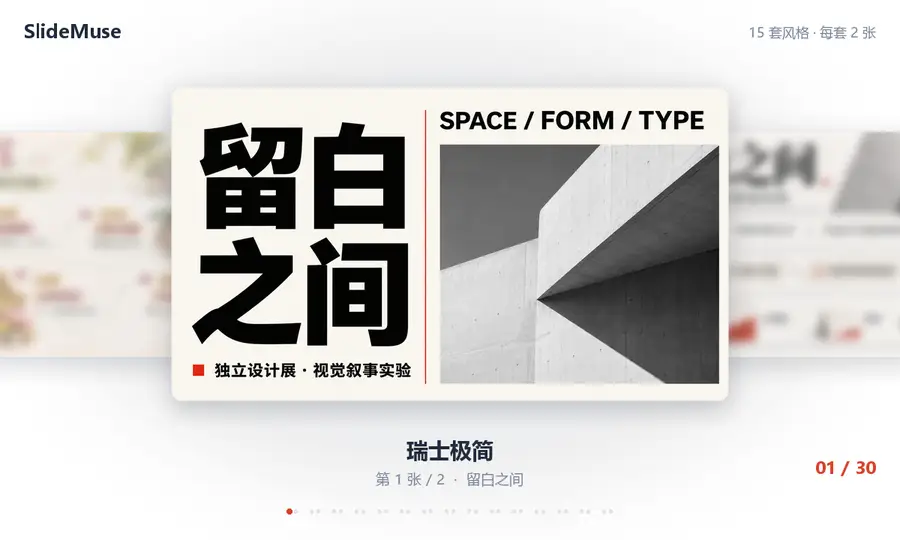
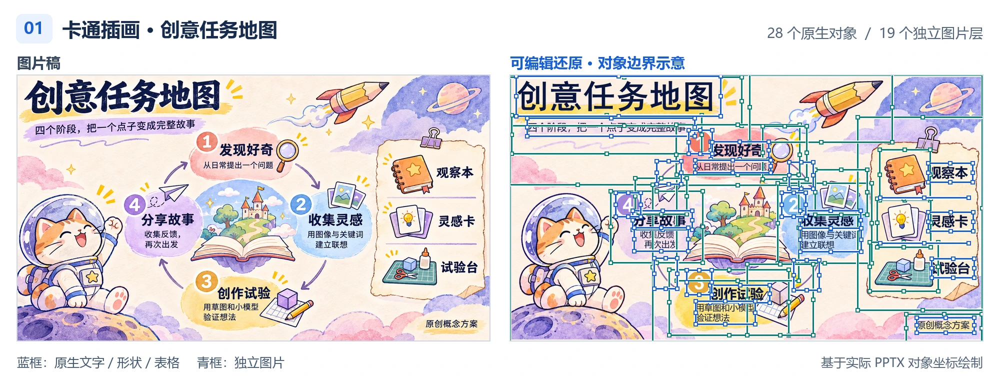
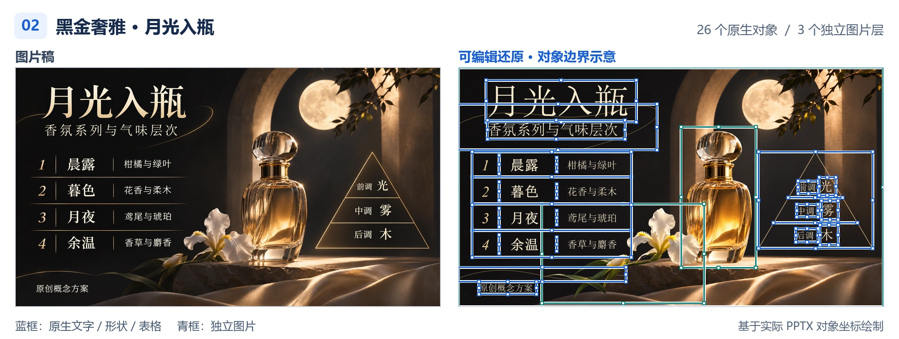
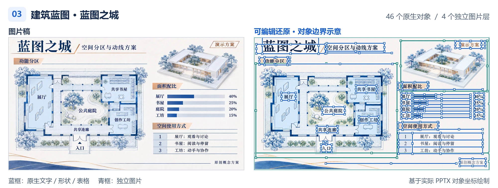
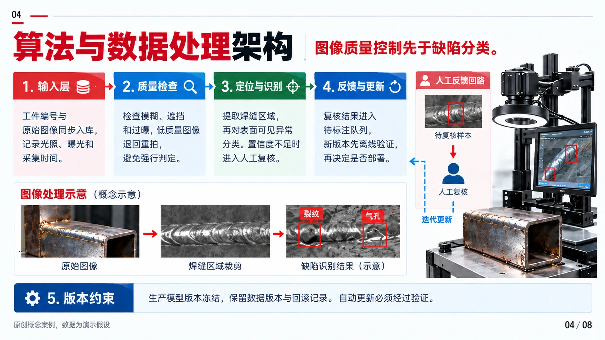
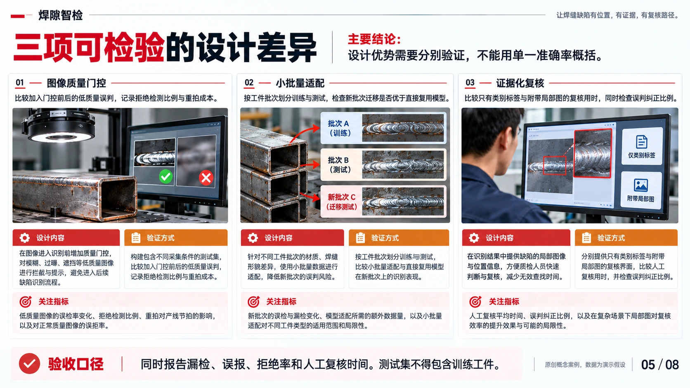
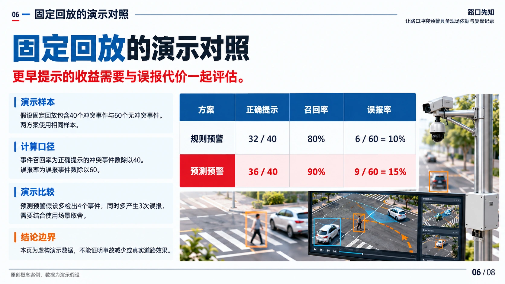
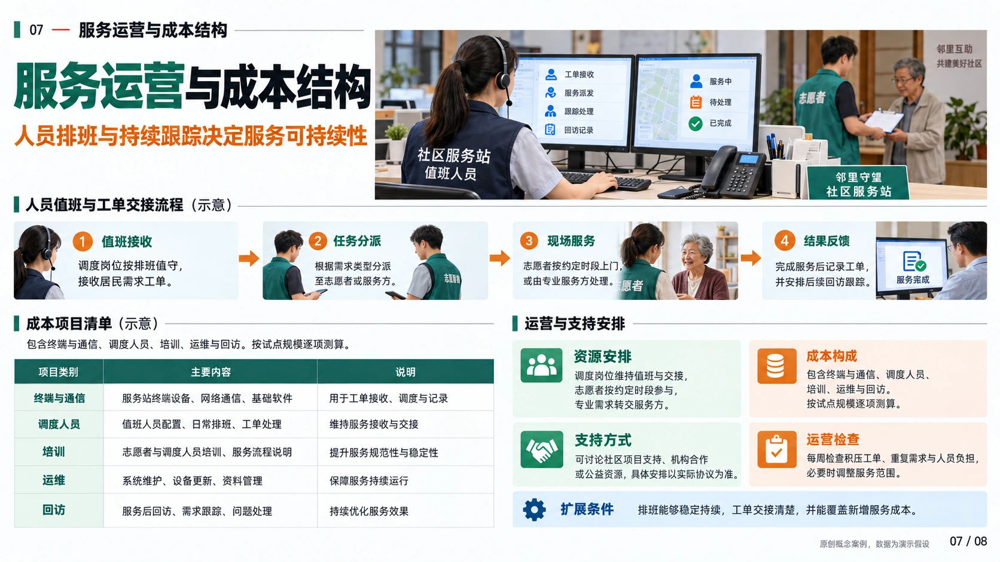

<div align="center">

# SlideMuse

**把内容变成值得展示的幻灯片。**

将 PDF、论文、报告与笔记制作成风格统一的图片 PPT，按需还原为可编辑 PPTX。<br>
用于工作汇报、教学培训、学术分享、竞赛答辩、产品路演与创意展示。

[](CHANGELOG.md)
[](https://github.com/helloo1568/slidemuse/actions/workflows/ci.yml)
[](LICENSE)

**简体中文** · [English](README.en.md)

[作品预览](#showcase) · [可编辑还原](#editable) · [竞赛答辩](#competition) · [快速开始](#quick-start) · [使用指南](docs/guide.md)

</div>

<div align="center">

<a href="https://fyai.uk/?utm_source=github&utm_medium=readme&utm_campaign=slidemuse"></a>

**本项目由 [风云AI](https://fyai.uk/?utm_source=github&utm_medium=readme&utm_campaign=slidemuse) 赞助** · 性价比很高的 AI 中转站<br>
GPT 调用低至 **0.08 倍率** · 生图 **0.02 元/张**（1K/2K/4K 同价）<br>
支持 Claude、GPT、Grok、Gemini 以及国产模型 · **全网最低价，0 掺水，高速满血不降智。**

没有 Codex 订阅或海外网络环境，也想发挥 SlideMuse 的最大能力？<br>
风云AI 提供 OpenAI 兼容 API，复制一段话即可接入生图后端 · [接入方法](docs/fyai-quickstart.md)

</div>

<a id="showcase"></a>



<p align="center"><sub>15 种风格 × 每种 2 页 · 每张 2 秒 · 同一风格连续展示</sub></p>

<a id="editable"></a>

## 好看，也能继续编辑

先生成完整图片稿，再按图还原。文字、形状和表格成为原生对象，复杂插画与照片拆成可独立替换的图片层。

<a href="https://github.com/helloo1568/slidemuse/blob/main/docs/assets/portfolio/editable-cartoon.png"></a>

<a href="https://github.com/helloo1568/slidemuse/blob/main/docs/assets/portfolio/editable-luxury.png"></a>

<a href="https://github.com/helloo1568/slidemuse/blob/main/docs/assets/portfolio/editable-blueprint.png"></a>

<sub>左侧为图片稿，右侧为 PowerPoint 渲染；边框与控制点依据实际 PPTX 对象坐标绘制。点击图片查看大图。</sub>

[下载这 3 页可编辑 PPTX](https://github.com/helloo1568/slidemuse/blob/main/showcase/editable/three-styles.pptx?raw=true) · [了解可编辑对象](docs/guide.md#每个元素可编辑是什么意思) · [更多作品](https://github.com/helloo1568/slidemuse/blob/main/docs/style-showcase.md)

<a id="competition"></a>

## 竞赛答辩，讲清创新、技术与成果

把项目书、论文、调研报告与赛事要求交给 SlideMuse，围绕问题、方案、创新与验证组织答辩页面。

<table>
<tr>
<td width="50%" align="center">
<a href="https://github.com/helloo1568/slidemuse/blob/main/showcase/competition-portfolio/assets/weld/04.webp"></a><br>
<strong>技术架构</strong><br><sub>看清系统与流程</sub>
</td>
<td width="50%" align="center">
<a href="https://github.com/helloo1568/slidemuse/blob/main/showcase/competition-portfolio/assets/weld/05.webp"></a><br>
<strong>创新对比</strong><br><sub>亮点对应验证方式</sub>
</td>
</tr>
<tr>
<td width="50%" align="center">
<a href="https://github.com/helloo1568/slidemuse/blob/main/showcase/competition-portfolio/assets/junction/06.webp"></a><br>
<strong>数据验证</strong><br><sub>结果附上对照与口径</sub>
</td>
<td width="50%" align="center">
<a href="https://github.com/helloo1568/slidemuse/blob/main/showcase/competition-portfolio/assets/neighbor/07.webp"></a><br>
<strong>应用落地</strong><br><sub>交代实施与资源安排</sub>
</td>
</tr>
</table>

<sub>节选自三套原创概念作品，共 24 页；以上为图片版展示，业务与技术数据为虚构演示输入。点击任一页面查看大图。</sub>

- **内容组织**：结合赛事要求与现有材料，安排问题、方案、创新与验证的叙事顺序。
- **图解表达**：用技术路线、系统架构、方案对比和数据结果，支撑项目的核心结论。
- **现场讲述**：按汇报时长安排逐页内容，按需提供讲解提纲、讲稿与演讲备注。

[浏览 24 页完整竞赛作品](https://github.com/helloo1568/slidemuse/blob/main/docs/competition-portfolio.md) · [查看完整赛事与答辩场景](https://github.com/helloo1568/slidemuse/blob/main/docs/competition-scenarios.md)

### 适用赛事与答辩场景

| 赛事 / 场景 | 可组织的汇报内容 |
| :--- | :--- |
| [中国国际大学生创新大赛](https://hudong.moe.gov.cn/srcsite/A08/s5672/202607/t20260731_1445670.html) | 项目痛点、创新方案、应用验证、团队与发展规划。 |
| [“挑战杯”中国大学生创业计划竞赛](https://www.tiaozhanbei.net/focus) | 用户需求、产品方案、市场分析、商业模式与实施计划。 |
| [全国大学生电子商务“创新、创意及创业”挑战赛](https://www.3chuang.net/) | 电商场景、创意方案、运营实践、项目成果与商业价值。 |
| [iGEM 国际基因工程机器大赛](https://igem.org/) | 项目背景、生物设计（Parts）、实验与建模证据、安全伦理、Human Practices 与团队协作。 |
| [霍特奖 Hult Prize](https://www.hultprize.org/) | 社会问题定义、方案与商业模式、impact 量化、团队执行力与 pitch 表达。 |
| [微软 Imagine Cup](https://imaginecup.microsoft.com/) | 技术实现与 AI 应用、产品可用性、市场与团队、Demo 完成度。 |
| [“挑战杯”全国大学生课外学术科技作品竞赛](https://www.tiaozhanbei.net/focus) | 研究问题、技术方法、创新点、实验结果与应用价值。 |
| [中国大学生计算机设计大赛](https://jsjds.blcu.edu.cn/) | 作品定位、功能演示、技术实现、难度与工作量、现场问答。 |
| [中国软件杯大学生软件设计大赛](https://www.cnsoftbei.com/) | 6 分钟讲清赛题理解、架构设计、功能演示、代码与文档质量；预留 4 分钟问答。 |
| 中国大学生服务外包创新创业大赛 | 企业命题契合度、产品完成度、商业模式与落地数据、Demo、团队分工。 |
| [全国大学生信息安全竞赛（作品赛）](http://www.ciscn.cn/) | 技术创新性、系统实现与现场演示、实战或应用价值、答辩。 |
| [全国大学生集成电路创新创业大赛（集创赛）](https://univ.ciciec.com/) | 赛题指标达成、工程实现与测试数据、产业适配性、现场评审问答。 |
| [全国大学生嵌入式芯片与系统设计竞赛](https://www.socchina.net/) | 芯片平台应用、系统集成与演示、方案文档、答辩。 |
| 全国大学生机械创新设计大赛 | 选题新颖实用、结构设计与理论方法、制作工艺与功能、实物演示与现场答辩。 |
| [全国大学生交通运输科技大赛（交科赛）](http://www.nactrans.net/) | 交通问题、方案设计、技术路线、实验或应用验证与创新价值。 |
| 全国大学生化工设计竞赛 | 工艺流程与绿色低碳、能量与物料集成、经济性分析、口头报告与两轮答辩。 |
| 世界职业院校技能大赛 | 围绕项目设计、工作流程、核心技能与主要成果组织现场讲解，结合技能操作展示实物与测试数据；辅助 PPT 按当届赛道要求制作。 |
| [全国大学生结构设计竞赛](http://www.structurecontest.com/) | 理论方案与计算书、模型制作与加载表现、现场陈述答辩、团队协作。 |
| [全国大学生节能减排社会实践与科技竞赛](https://jienengjianpai.cn/) | 能耗与排放问题、技术或社会实践方案、实测数据、减排效益核算、可推广性。 |
| [全国三维数字化创新设计大赛（3D 大赛）](https://3dds.3ddl.net/) | 数字建模与创新、工程实用性、商业或社会价值、路演与评委问辩。 |
| [全国大学生广告艺术大赛（大广赛·策划案类）](https://www.sun-ada.net/) | 品牌与人群洞察、创意与命题契合、策划案逻辑与可执行、现场提案表达。 |
| [睿抗机器人开发者大赛（RAICOM）](https://www.raicom.com.cn/) | 赛项任务完成、设计创意、PPT 答辩表达。 |
| [中国研究生创新实践系列大赛](https://cpipc.acge.org.cn/) | 技术创新、工程实现与效果、应用价值；按具体子赛、届次与阶段确定匿名要求及汇报、问答时长。 |
| [“正大杯”全国大学生市场调查与分析大赛](https://www.china-cssc.org/show-568-1912-1.html) | 调研问题、调查设计、数据分析、主要发现与建议。 |
| [全国大学生生命科学竞赛](https://www.culsc.cn/) | 科学问题、实验设计与技术路线、数据与统计学、结论可靠性、答辩问答。 |
| [中国大学生工程实践与创新能力大赛](http://www.gcxl.edu.cn/) | 任务拆解、方案对比、结构与控制设计、实测成绩、迭代改进。 |
| [中国研究生公共管理案例大赛](https://cpipc.acge.org.cn/cw/hp/8) | 案例典型性、理论框架、问题诊断、对策可行性、问答。 |
| [中国 MPAcc 学生案例大赛](http://alds.mpaccesc.ruc.edu.cn/) | 财务分析、问题诊断、方案落地、数据支撑、答辩。 |
| [IMA 校园管理会计案例大赛](https://casecompetition.imachina.org.cn/) | 管理会计工具应用、数据测算、方案可执行性、展示与问答。 |
| [CFA Institute Research Challenge](https://researchchallenge.cfainstitute.org/) | 估值模型、投资建议与目标价、行业与护城河、英文表达与问答、合规披露。 |
| [全国高校教师教学创新大赛](https://nticct.cahe.edu.cn/) | 教学痛点、创新点与课程重构、评价改革、证据链（数据与学生反馈）、推广性。 |
| [田家炳杯全国师范院校师范生教学技能竞赛](https://qgjxjn.zjnu.edu.cn/) | 教学目标与课标对应、学情分析、教学环节设计、板书与课件、课堂应变。 |
| 全国中小学实验教学说课活动 | 实验改进点、教学目标达成、安全与规范、说课表达。 |
| **大学生创新创业训练计划（大创）** | 立项答辩、中期汇报与结题答辩：项目目标、研究与实施方案、阶段进展、成果与后续计划。 |
| **论文答辩与组会汇报** | 研究问题、相关工作、方法设计、实验结果、主要贡献与后续研究。 |
| **校内或省级数模答辩、优秀论文交流** | 问题分析、假设与模型、求解方法、结果检验、灵敏度分析与模型评价。 |

<a id="quick-start"></a>

## 快速开始

将下面的话发给 **Codex / Claude Code / OpenCode / WorkBuddy / Trae / Qoder**：

```text
安装 SlideMuse，仓库是 https://github.com/helloo1568/slidemuse 。
请运行仓库自带的 install.py，注册 Skill、安装隔离依赖并完成自检。
如果检测到多个客户端，请用 --client 指定当前客户端。
```

安装后附上材料，直接说（Codex 也可使用 `$slidemuse`）：

**示例一：通用汇报**

```text
使用 slidemuse 技能，把这份报告做成 10 页项目汇报 PPT，受众是团队同事。
先给我逐页内容方案，再提供四套风格总览供我选择。
选定后制作图片版，并继续还原为可编辑 PPTX。
```

**示例二：竞赛答辩**

```text
使用 slidemuse 技能，根据这份项目书和赛事要求制作 8 分钟竞赛答辩 PPT。
重点讲清项目痛点、技术方案、创新点与验证结果，并给出逐页讲解提纲。
先给我逐页内容方案，再提供四套风格总览供我选择。
选定后制作图片版，并继续还原为可编辑 PPTX。
```

默认先确认内容、再选择风格。只需要图片版，或已有图片需要还原，都可以直接说明；已授权的选择会继续执行。

<details>
<summary>手动安装与运行条件</summary>

需要 **Python 3.10+**；使用下面的克隆命令还需 Git。

```sh
git clone https://github.com/helloo1568/slidemuse.git slidemuse
python slidemuse/install.py
```

同时检测到多个客户端时，指定当前客户端，例如：

```sh
python slidemuse/install.py --client codex
python slidemuse/install.py --client workbuddy
python slidemuse/install.py --client trae
python slidemuse/install.py --client qoder
```

Trae 国内版使用 `--client trae-cn`，Qoder 国内版使用 `--client qoder-cn`。各客户端目录与启用方法见[客户端适配](docs/clients.md)。

宿主 Agent 提供材料读取、视觉理解、生图与本地文件操作能力。PPTX 渲染使用已安装的 PowerPoint，或 LibreOffice + Poppler。完整安装说明见[使用指南](docs/guide.md#快速开始)。

</details>

## 从材料到交付

| 内容与风格 | 图片版 PPT | 可编辑还原（按需） |
| :--- | :--- | :--- |
| 提炼逐页内容，比较四套视觉方向 | 逐页生成并核对，组装图片版 PPTX | 按图拆分文字、形状、表格与独立素材 |
| 确定叙事与版式 | 得到完整图片和演示文稿 | 得到可继续修改的 PPTX |

支持演讲备注、任务恢复和局部修改。已有幻灯片图片、扫描 PDF 或图片版 PPTX，可以直接进入可编辑还原。

## 文档与社区

| 想做什么 | 从这里开始 |
| :--- | :--- |
| 了解安装、流程与使用方法 | [使用指南](docs/guide.md) · [客户端适配](docs/clients.md) · [Agent 技能](SKILL.md) |
| 查看命令、恢复任务与检查交付 | [命令指南](docs/cli.md) · [交付流水线](references/pipeline.md) |
| 深入图片生成与可编辑还原 | [图片生成](references/generate-backend.md) · [可编辑重建](references/editable-backend.md) |
| 保留讲稿、精确绘图与更新数据 | [演讲备注](references/speaker-notes.md) · [图表与数据](references/chart-reliability.md) |
| 查看竞赛场景与完整作品 | [竞赛场景参考](https://github.com/helloo1568/slidemuse/blob/main/docs/competition-scenarios.md) · [完整作品集](https://github.com/helloo1568/slidemuse/blob/main/docs/competition-portfolio.md) |
| 反馈与贡献 | [Discussions](https://github.com/helloo1568/slidemuse/discussions) · [贡献指南](CONTRIBUTING.md) · [更新记录](CHANGELOG.md) |

感谢 [PPT Master](https://github.com/hugohe3/ppt-master)、[banana-slides](https://github.com/Anionex/banana-slides)、[PPTAgent](https://github.com/icip-cas/PPTAgent) 及教程作者带来的启发。集成后端保留 [codex-ppt-skill](https://github.com/ningzimu/codex-ppt-skill) 与 [image-to-editable-ppt-skill](https://github.com/ningzimu/image-to-editable-ppt-skill) 的 MIT 来源，详见[来源与取舍](references/research.md)。

<div align="center">

[MIT License](LICENSE) © 2026 风清云影（[helloo1568](https://github.com/helloo1568)）

</div>
