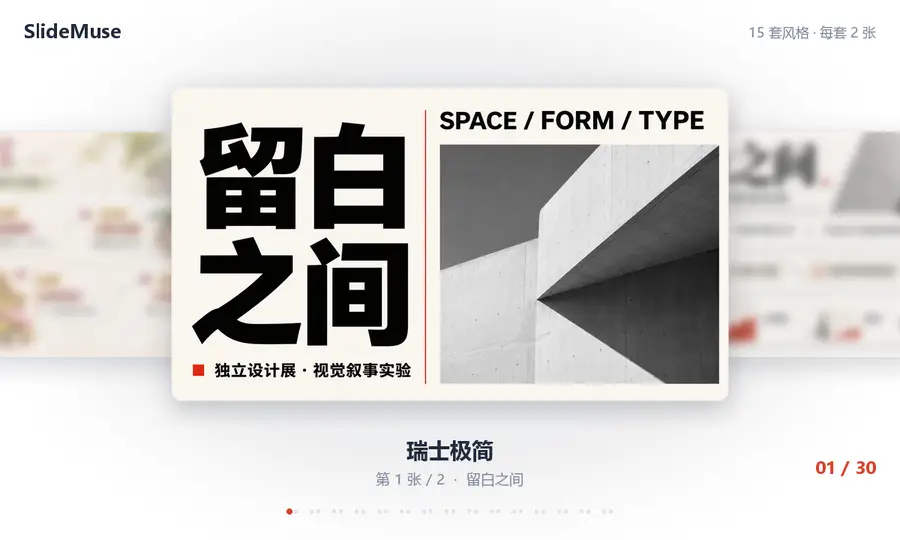
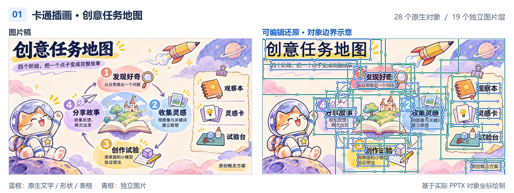
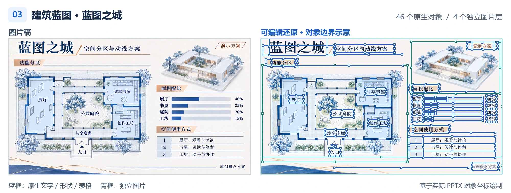

<div align="center">

# SlideMuse

**把内容变成值得展示的幻灯片。**

将 PDF、论文、报告与笔记制作成风格统一的图片 PPT，按需还原为可编辑 PPTX。<br>
用于工作汇报、教学培训、学术分享、竞赛答辩、产品路演与创意展示。

[](CHANGELOG.md)
[](https://github.com/helloo1568/slidemuse/actions/workflows/ci.yml)
[](LICENSE)

**简体中文** · [English](README.en.md)

[作品预览](#showcase) · [可编辑还原](#editable) · [竞赛特色](#competition) · [快速开始](#quick-start) · [使用指南](docs/guide.md)

</div>

<a id="showcase"></a>



<p align="center"><sub>15 种风格 × 每种 2 页 · 每张 2 秒 · 同一风格连续展示</sub></p>

<a id="editable"></a>

## 好看，也能继续编辑

先生成完整图片稿，再按图还原。文字、形状和表格成为原生对象，复杂插画与照片拆成可独立替换的图片层。

<a href="https://github.com/helloo1568/slidemuse/blob/main/docs/assets/portfolio/editable-cartoon.png"></a>

<a href="https://github.com/helloo1568/slidemuse/blob/main/docs/assets/portfolio/editable-luxury.png"></a>

<a href="https://github.com/helloo1568/slidemuse/blob/main/docs/assets/portfolio/editable-blueprint.png"></a>

<sub>左侧为图片稿，右侧为 PowerPoint 渲染；边框与控制点依据实际 PPTX 对象坐标绘制。点击图片查看大图。</sub>

[下载这 3 页可编辑 PPTX](https://github.com/helloo1568/slidemuse/blob/main/showcase/editable/three-styles.pptx?raw=true) · [了解可编辑对象](docs/guide.md#每个元素可编辑是什么意思) · [更多作品](https://github.com/helloo1568/slidemuse/blob/main/docs/style-showcase.md)

<a id="competition"></a>

## 竞赛答辩，也是我们的特色

把项目书、论文、调研报告与赛事要求转成答辩页面，围绕问题、方案、创新、验证与价值组织内容，让技术与成果更容易讲清楚。

| 场景 | 代表赛事与展示重点 |
| :--- | :--- |
| **创新创业路演** | 挑战杯、中国国际大学生创新大赛、三创赛：需求洞察、创新方案、应用验证与发展计划。 |
| **科技与工程答辩** | 计算机设计大赛、软件杯、集创赛、交科赛：技术路线、系统实现、测试结果与现场演示。 |
| **调研与案例分析** | 正大杯、MPA / MPAcc、IMA、CFA：研究方法、数据分析、核心发现与建议。 |
| **教学与学术展示** | 教创赛、师范生说课、校内或省级数模答辩：目标、方法、证据与成果表达。 |

[查看完整赛事与答辩场景](https://github.com/helloo1568/slidemuse/blob/main/docs/competition-scenarios.md) · [浏览 24 页完整竞赛作品](https://github.com/helloo1568/slidemuse/blob/main/docs/competition-portfolio.md)

<a id="quick-start"></a>

## 快速开始

将下面的话发给 **Codex / Claude Code / OpenCode / WorkBuddy / Trae / Qoder**：

```text
安装 SlideMuse，仓库是 https://github.com/helloo1568/slidemuse 。
请运行仓库自带的 install.py，注册 Skill、安装隔离依赖并完成自检。
如果检测到多个客户端，请用 --client 指定当前客户端。
```

安装后附上材料，直接说（Codex 也可使用 `$slidemuse`）：

```text
使用 slidemuse 技能，把这份报告做成 10 页项目汇报 PPT，受众是团队同事。
先给我逐页内容方案，再提供四套风格总览供我选择。
选定后制作图片版，并继续还原为可编辑 PPTX。
```

默认先确认内容、再选择风格。只需要图片版，或已有图片需要还原，都可以直接说明；已授权的选择会继续执行。

<details>
<summary>手动安装与运行条件</summary>

需要 **Python 3.10+**；使用下面的克隆命令还需 Git。

```sh
git clone https://github.com/helloo1568/slidemuse.git slidemuse
python slidemuse/install.py
```

同时检测到多个客户端时，指定当前客户端，例如：

```sh
python slidemuse/install.py --client codex
python slidemuse/install.py --client workbuddy
python slidemuse/install.py --client trae
python slidemuse/install.py --client qoder
```

Trae 国内版使用 `--client trae-cn`，Qoder 国内版使用 `--client qoder-cn`。各客户端目录与启用方法见[客户端适配](docs/clients.md)。

宿主 Agent 提供材料读取、视觉理解、生图与本地文件操作能力。PPTX 渲染使用已安装的 PowerPoint，或 LibreOffice + Poppler。完整安装说明见[使用指南](docs/guide.md#快速开始)。

</details>

## 从材料到交付

| 内容与风格 | 图片版 PPT | 可编辑还原（按需） |
| :--- | :--- | :--- |
| 提炼逐页内容，比较四套视觉方向 | 逐页生成并核对，组装图片版 PPTX | 按图拆分文字、形状、表格与独立素材 |
| 确定叙事与版式 | 得到完整图片和演示文稿 | 得到可继续修改的 PPTX |

支持演讲备注、任务恢复和局部修改。已有幻灯片图片、扫描 PDF 或图片版 PPTX，可以直接进入可编辑还原。

## 文档与社区

| 想做什么 | 从这里开始 |
| :--- | :--- |
| 了解安装、流程与使用方法 | [使用指南](docs/guide.md) · [客户端适配](docs/clients.md) · [Agent 技能](SKILL.md) |
| 查看命令、恢复任务与检查交付 | [命令指南](docs/cli.md) · [交付流水线](references/pipeline.md) |
| 深入图片生成与可编辑还原 | [图片生成](references/generate-backend.md) · [可编辑重建](references/editable-backend.md) |
| 保留讲稿、精确绘图与更新数据 | [演讲备注](references/speaker-notes.md) · [图表与数据](references/chart-reliability.md) |
| 查看竞赛场景与完整作品 | [竞赛场景参考](https://github.com/helloo1568/slidemuse/blob/main/docs/competition-scenarios.md) · [完整作品集](https://github.com/helloo1568/slidemuse/blob/main/docs/competition-portfolio.md) |
| 反馈与贡献 | [Discussions](https://github.com/helloo1568/slidemuse/discussions) · [贡献指南](CONTRIBUTING.md) · [更新记录](CHANGELOG.md) |

感谢 [PPT Master](https://github.com/hugohe3/ppt-master)、[banana-slides](https://github.com/Anionex/banana-slides)、[PPTAgent](https://github.com/icip-cas/PPTAgent) 及教程作者带来的启发。集成后端保留 [codex-ppt-skill](https://github.com/ningzimu/codex-ppt-skill) 与 [image-to-editable-ppt-skill](https://github.com/ningzimu/image-to-editable-ppt-skill) 的 MIT 来源，详见[来源与取舍](references/research.md)。

<div align="center">

[MIT License](LICENSE) © 2026 风清云影（[helloo1568](https://github.com/helloo1568)）

</div>
